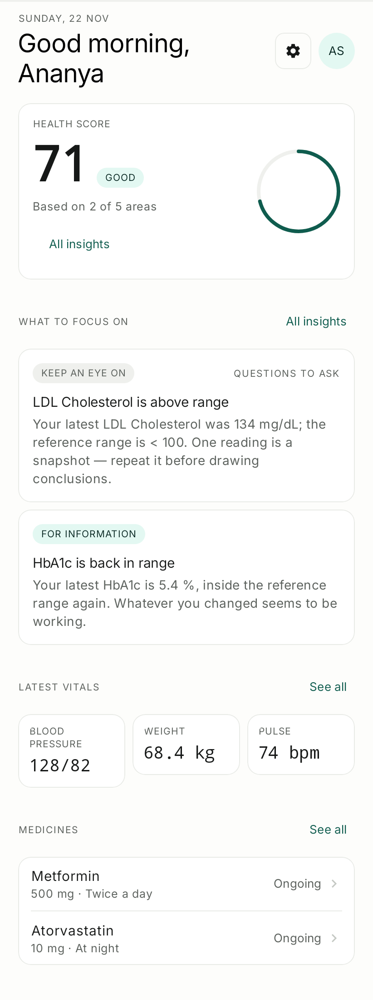
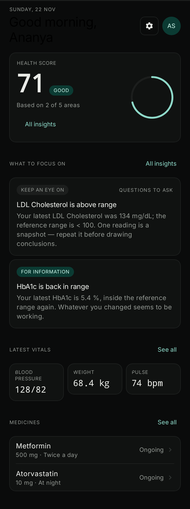
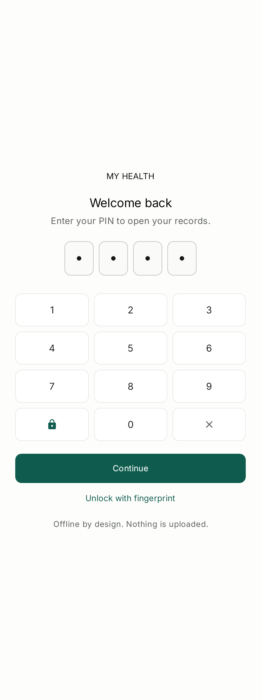
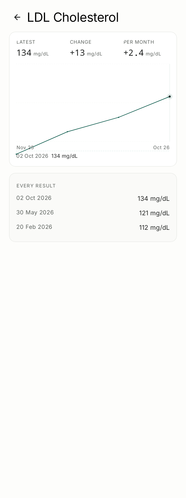

# My Health

A private, offline-first Android health-record app. Lab reports, prescriptions and pharmacy bills are
read **on this phone** (PDF text layer → raster → ML Kit OCR), filed chronologically over the last three
years, and turned into explainable trends, focus cards and a health score.

* **Offline by design** — no account, no cloud, no analytics. The only optional network exchange is the
  Google sign-in handshake, and the app is fully usable without it.
* **Encrypted at rest** — SQLCipher database with a Keystore-wrapped passphrase, AES-GCM attachment vault,
  encrypted preferences, PIN/biometric app lock and `FLAG_SECURE` support.
* **One hue** — a single deep-pine accent with warm neutrals; status is always icon + wording + fill, never
  colour alone.
* **Three languages** — English (default), Hindi and Gujarati (translation files in progress; see
  `TASKS.md` T-035).
* **Medical safety** — extraction is reviewed by the user before saving; every insight carries its
  rationale and a "discuss with your doctor" disclaimer. Not a medical device.
* **Design language** — layout, surfaces and motion follow [Rare UI](https://rareui.com) (MIT + Commons
  Clause + Attribution, © Swami Malode), reimplemented natively in Compose under the single-hue rule.
  See [`docs/DESIGN_SYSTEM.md`](docs/DESIGN_SYSTEM.md).

## Screenshots

Rendered from the real Compose UI by a Robolectric screenshot test (`ScreenshotGalleryTest`), not
mockups. More in [`docs/screenshots`](docs/screenshots) and on the
[preview release](https://github.com/solerunner26/MyHealth/releases/tag/preview-rare-ui-2026-11-22).

| Home | Home (dark) | Unlock | Trends |
| --- | --- | --- | --- |
|  |  |  |  |

## Build

```bash
tools/bootstrap-env.sh      # JDK 21 + Gradle 9.9.2 + Android SDK 37.2 (about 3 GB, once)
source tools/env.sh
./gradlew :app:assembleDebug
./gradlew :app:testDebugUnitTest
```

Details, pins and signing: [`docs/BUILD_AND_RELEASE.md`](docs/BUILD_AND_RELEASE.md).
Session state and next steps: [`HANDOFF.md`](HANDOFF.md) and [`TASKS.md`](TASKS.md).

## Toolchain

AGP 9.5.1 with built-in Kotlin (never add the Kotlin Android plugin), Compose BOM 2026.11.01,
compileSdk 37.2, minSdk 26. Persistence is hand-written SQL over SQLCipher — no Room, no KSP, no kapt.

## Privacy

`allowBackup=false`, no analytics SDK, no crash uploader, attachments encrypted on disk. Everything the
app knows lives in app-private storage and can be erased from Settings → *Erase all data*.
